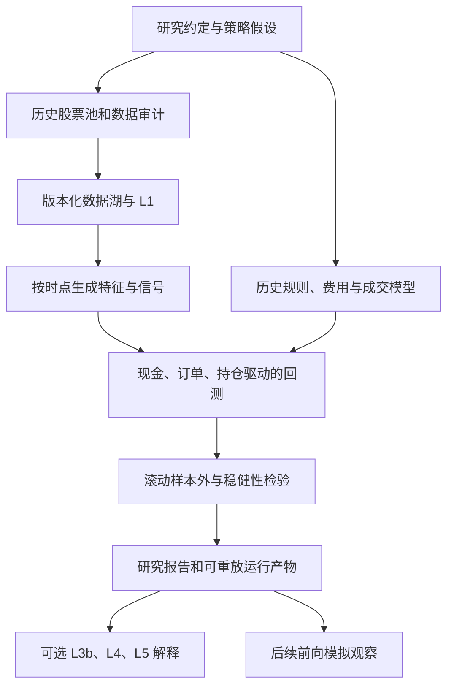

# A 股短线交易研究系统：任务重组与资料清单

> 计划日期：2026-11-07。状态：已有开源复用接入原型，正式研究主线尚未验收。进展见 [README](../README.md)。  
> 本文定义整个项目的交付目标与任务顺序；[ARCHITECTURE.v3.md](../ARCHITECTURE.v3.md) 作为历史状态和证据子系统的设计依据。原文将回测与可成交性延后的安排，不再适用于首版短线研究主线。

## 1. 已确认的目标与待定约定

用户已确认：首版研究沪深主板股票，暂排 ST 与新股；计划持有 1–5 个交易日；盘后生成信号，下一交易日开盘模拟执行；主要产物是策略回测与研究报告。

沿用此前边界：研究、回测和虚拟持仓，不连接真实账户；PIT 单闸门；所有计算归代码；模型只在 L3b、L4、L5 提供受契约限制的解释、证据检查和报告合成；不引入重编排框架。回测器内必须有虚拟现金、订单、持仓和权重规则，才能算策略表现，这些是试验参数，不是给用户的实际仓位建议。

以下仍是**假设**，不得未经确认当作用户偏好：

- “新股”暂沿用原 v1 的上市满 60 个交易日条件。它是研究筛选参数，与交易所对上市初期交易规则的定义分别管理。
- 持有期 `h` 按实际买入成交之后跨过的交易日计数。若信号日为 `t`、在 `t+1` 开盘成交，`h=1` 的计划退出是 `t+2` 开盘；`h=5` 是 `t+6` 开盘。这样避免把新买入股票安排在买入当日退出；用户可改此研究约定。
- 首轮先做价格、成交量和流动性规则，不把尚未齐备的预期、政策、事件和财务分位设为先决条件。估值是可选背景变量，其短线增量须经试验验证。
- 数据区间、模拟规模、成本约定和研究证据门槛尚待确定。可先由研究设计提出、版本化并明确标注情景，不替用户设个人风险偏好；在首次查看相关收益前完成约定。约定未冻结时只能出工程样例和探索报告。

## 2. 原要求缺少或需调整的部分

| 缺口 | 为什么原来的状态系统覆盖不了 | 本轮增加的任务 |
| --- | --- | --- |
| 可证伪的策略问题 | “处于何种状态”没有规定状态对未来什么结果有意义 | 写明假设、信号时刻、入选与退出规则、对照组、拒绝假设的条件 |
| 当时的股票池 | 当前幸存股票和当前 ST 名单不能替代历史可选范围 | 主板归属、上市/退市、风险警示与停复牌历史，保留后来退市的历史样本 |
| 成交与资金状态 | 未来收益均值不是可实施的组合收益 | 现金/可卖持仓、订单、成交、未成交、延迟退出、公司行为与费用 |
| 结果标签的时钟 | 从信号收盘起算会把成交前跳空算进策略 | 特征截止、订单提交、成交、退出、标签成熟时间分别保存 |
| 成本与规模 | 小幅毛收益可能被费用与滑点覆盖，开盘成交也有容量约束 | 按生效日的费率；模拟规模、开盘数据精度和成本敏感性 |
| 防研究过拟合 | 挑中最好的历史曲线仍不能证明有效 | 记录所有试验、冻结样本外、滚动验证、重叠标签隔离与稳健性检查 |
| LLM 隐性前视 | 数据过 L1 不代表模型权重中没有后来事实 | 代码基线、匿名对照、只解释不改信号、前向验证；复盘记忆也受时点约束 |
| 独立评价体系 | 文案正确、状态正确、交易赚钱是不同检验 | 分别评价工程契约、信号研究、可成交组合与 LLM 增量 |

原来的五维可以保留为解释视图，不是每个短线策略必须具备的五组数据。首次交付无需补齐全部 57 个数据集；必须先补齐所选价格成交量研究的依赖。

## 3. 本次只读核查得到的数据起点

工程：`E:\security-lab\cnequity-lab`。数据湖：`E:\security-lab\cnequity-lab\data\cnequity-demo`。配置为 `demo`。本次读取 Parquet 聚合与 SQLite manifest；没有抓数、安装或修改原工程。

| 项目 | 2026-11-07 本次读表结果 | 对计划的影响 |
| --- | --- | --- |
| `daily_bars` | 150 行、5 票；2026-09-17 至 2026-11-05；`pre_close` 非空数为 0 | 只够小样本工程验证，不能验证市场级短线效果 |
| `financial_statement_items` | 1,620,056 行、5,579 票；`available_at` 非空数为 0 | 财务覆盖不等于有同等股票池、价格覆盖和历史版本证据 |
| `instruments` | 5 票；`list_date`、`delist_date` 均空；样本含一只创业板股票 | 当前不能构造用户要求的沪深主板历史股票池，也不能执行新股过滤 |
| `share_structure` | 1 票、16 行、16 个不同变更日；来源 `eastmoney_backfill` | 更新了原文的 8 个变更点；仅说明该数据集有回填，不说明东财其他接口已恢复 |
| `adj_factors` | 150 行、5 票，与 demo 行情区间相同 | 不能替代完整的现金分红、送转和股本变动事件账本 |
| `trading_calendar` | 2,867 个自然日，其中 1,903 个交易日标志为真 | 所有窗口必须过滤交易日，未来日历预测与历史公告分开 |
| `trading_status` / `announcement_index` / `corporate_actions` | 对应 curated/derived 目录没有 Parquet 文件 | 风险警示、新股、停牌、除权分红与事件研究的关键依赖尚未满足 |
| 工程形态 | 原型入口为 `asof.py` 与探测脚本；本次规划目录 `D:\lianghua` 未见 Git 仓库 | 先采用直接文件模式规划；实现时锁定依赖和源代码树哈希，建立版本管理后再绑定提交 |

这些是本次聚合检查，不是完整的数据验收。源修订链、全量单位、各票缺口及源日线是否含盘后固定价格交易仍待审计。D 盘本次约有 108.6 GiB 可用、E 盘约有 191.4 GiB 可用；这是当前快照，不据此承诺分钟或逐笔数据容量。内存信息本次 CIM 读取不可用，实施前再核查。

## 4. 研究主线与底层关系

继续采用 Python 模块化单体、Parquet、DuckDB、SQLite。向量化特征与有状态成交模拟分工；策略先写成注册函数和版本化参数，不先建完整 DSL。SQLite 管理研究与运行索引，大批信号、订单、成交和净值按 `run_id` 保存为 Parquet/JSON 产物。

所有研究读取仍经同一个 L1：策略的 `decision_view(cutoff=t)` 只见 `t` 之前的数据；模拟器时钟前进到 `s` 后才取得 `s` 的市场结果。标签/评价读取使用受限的 outcome 用途，并与策略输入隔离。未来标签、平仓结果、复盘经验不能回流到较早的决策视图。它是同一闸门内的权限与时钟约束，不增加旁路。

时间约束须落实到事件和字段：`open_event(s)` 只提供开盘价、当时已可见的交易状态和有效价格规则；当日 H/L/C/V 及全日状态汇总在对应事件完成后才开放，不能用于开盘撮合或拒单。由事后日线重建的开盘事件须标明其重建来源，不能假装存在同期盘口证据。开盘价属于提交后的执行输入，不得用于回改提交前的选股、数量和限价。

历史回填若缺同期版本证明，经 L1 进入明确标注的 `reconstructed` 探索运行，枚举沿用 v3；不与 `verified_visible` 运行合并宣称严格 PIT。对缺修订历史的财务变量可先停用。严格历史状态产品的拒答标准继续有效，数据归档开始后积累可验证的前向样本。

## 5. 首版研究约定必须落成的配置

| 配置项 | 必须明确的内容 |
| --- | --- |
| 股票池 | 历史主板归属、风险警示排除、新股期限、上市/退市、状态缺失的去向 |
| 信号时钟 | 盘后何时数据完成、公告截止、源可用时间；日线含何种交易时段 |
| 策略假设 | 预期影响机制、所用指标、入选与退出规则、参数搜索范围、无信号行为 |
| 成交约定 | 次日开盘代理及版本、提交时点、订单有效期、分方向的涨跌停拒单规则、未成交和部分成交处理、开盘跳空处理 |
| 计划持有期 | 从实际成交计算的 1–5 日；停牌或跌停无法退出时继续持有并报告实际期限 |
| 虚拟组合 | 模拟资金、固定股数或权重、持仓上限、同票重复信号、重叠批次、现金不足处理 |
| 成本 | 佣金及最低收费、税费、其他费用、滑点/冲击情景；适用生效日与避免重复计费 |
| 样本与检验 | 历史区间、训练/验证/最终留出及访问权限、参数尝试账本、基准、主评价指标与停止条件；首次看收益前冻结 |

“排除 ST”只限制新开仓；股票在持有中被风险警示、停牌或退市时，仍须保留持仓并按真实可得信息处理，不能从净值中消失。退出日无可执行价格时，不得按旧收盘价假装卖出。

无法退出但仍有可靠估值的持仓继续计价，并报告流动性限制；无法可靠计价的持仓使受影响净值及依赖指标标为不可验收。可以另列显式估值情景及范围，不能沿用旧价后给出无条件的策略有效结论。

只用日线时，次日开盘成交是代理假设。即使当日有成交或开盘不在涨停价，也不能由此证明该订单可按开盘价全部成交。没有集合竞价或相应开盘窗口成交量时，报告必须标 `fill_fidelity=daily_proxy`；队列与容量无法验证。日总成交量不能当成开盘时已知流动性用于下单，最多作为事后诊断。若策略优势依赖排队、秒级成交或精确开盘容量，需要相应数据后才能得出结论。

首个保守代理规定：开盘停牌、状态未知或适用价格限制不可计算时拒绝模拟成交；有价格限制时，买入在开盘达到涨停价则未成交，卖出在开盘达到跌停价则延迟退出。当天后来打开涨跌停不追认开盘成交。不受价格限制的特殊时段依历史规则单独处理。其他情况下的全额成交仍只是代理情景；部分成交比例只能来自该时刻适用的数据或事前固定的敏感性情景，禁止由当天后续量价反推。涨跌停参考价须有来源或可验证的历史计算链；现有 `pre_close` 全空时不能直接拿前一日收盘价替代除权等特殊参考价。

订单股数、限价和现金预算使用提交前可见信息确定；不能事后根据实际开盘价重新选股或优化数量。现金不足、超限价或价格规则失效按预注册规则拒单/未成交，保持完整日志。开盘跳空与卖出失败会影响之后所有现金和信号执行，必须重跑状态机。

不在日线 OHLC 中猜测同日先触止损还是先触止盈。首版采用明确的时间退出；若引入盘中退出，要有分钟等合适数据或显式的多种路径情景，并遵守新购股份可卖约束。

## 6. 必要数据与降级

| 数据 | 首版优先级 | 缺失时能做什么 |
| --- | --- | --- |
| 历史证券主表、主板归属、上市/退市日期 | P0 | 可跑固定样例；不能声称历史主板股票池研究 |
| 全研究区间的未复权 OHLCV/成交额及源版本 | P0 | 现有 demo 做工程验证；不足区间不外推 |
| 历史 ST、停复牌、价格限制及特殊交易状态 | P0 | 标记状态未知；不能默认为普通可交易股票，也不能静默剔除后宣称全市场 |
| 除权、现金分红、送转等公司行为与因子 | P0 | 受影响区间的完整现金/股数/收益核算不可验收；不得靠删日隐藏缺口 |
| 历史交易日历、有效日期规则和费用 | P0 | 规则缺失时对应模拟失败，不套当前规则回推 |
| 同口径基准或历史可选池对照 | P0 | 能出策略原始描述，不能给出可靠超额结论 |
| 集合竞价/开盘窗口数据 | P1：提高成交保真度 | 日线代理可以探索，不证明真实排队与容量 |
| 财务、估值 | P1：具体假设需要时 | 原型的单位和修订缺口不解，先不进入信号 |
| 公告、研报、政策与行业事件 | P1/P2：具体文本假设需要时 | 缺维度明确不可得；不阻塞首轮量价基线 |
| 全市场分钟、逐笔、订单簿 | 后续按研究问题取 | 不先铺全市场高频数据，也不声称日线回测支持盘中策略 |

建议先清点可获取的多年度日线与历史状态，再决定确切区间；区间须包含不同市场阶段、足够独立日期及完整留出，不用“拿到若干年”代替覆盖和独立性验收。历史版本证据不齐的范围单独列出。

## 7. 工作包与依赖

以下是正式能力的建设顺序。2026-11-07 已完成 W1/W2/W3 的部分接入验证：a-stock-data / BaoStock、AKShare 新浪接口与 AKQuant 合成撮合；详细范围见 README，不能视为工作包整体完成。真实绩效结论必须等待数据与模拟器两条线同时通过。

2026-11-09（北京时间）：W1 接通沪深交易所上市及终止上市名录的原始采集，尚不能据此形成历史合格股票池。W2 已能固定日线与日历版本，区分决策、开盘参考价和评价切片，并重演真实快照上的诊断场景。严格历史版本、同日盘后可见性以及正式运行的权限隔离仍待实现。证据见[本轮验证](../artifacts/w1-w2-verification-4c1c54fa8963427e9f7859587f5fc7c5/verification.json)。

| 工作包 | 交付物 | 依赖 | 模型/执行建议 |
| --- | --- | --- | --- |
| W0 研究约定 | 版本化 `research_spec` 和未决输入 | 已确认范围 | 默认；关键边界由强模型复核 |
| W1 数据与股票池验收 | 覆盖矩阵、源试点、历史股票池、缺口清单 | W0 | 默认实现与抽样核验 |
| W2 PIT 与运行身份 | 不可变清单、唯一闸门、事实与结果隔离 | W0；W1 样本 | 强模型设计，默认实现 |
| W3 历史规则与成交内核 | 规则库、成本、现金/订单/持仓状态机 | W0；W1 样本；真实运行依赖 W2 | 强模型审设计与会计不变量 |
| W4 特征、标签与试验账本 | 特征注册、成熟标签、完整 trials、留出封存 | W0、W2；接口可与 W3 并行，成交型标签验收依赖 W3 | 默认；时间泄漏边界复核 |
| W5 首轮确定性基线 | 小量预注册量价假设与对照结果 | W1–W4 | 默认，不调用 LLM 生成信号 |
| W6 样本外与稳健性 | 执行已冻结评价、成本/延迟/参数敏感性 | W5；留出约定已在 W0/W4 封存 | 强模型复核结论资格 |
| W7 研究报告与回放 | 报告、订单成交净值、证据与差分 | W6；展示骨架可从 W0 后开始 | 默认 |
| W8 LLM 解释与增量试验 | 三处模型契约、消融与污染诊断 | W7；文本数据按需来自 W1 | 强模型设计提示词，代码校验 |
| W9 前向观察 | 冻结信号、次日记录、模型与成交误差 | 工程可用后；不阻塞首版历史报告 | 默认；数据自动化后再安排 |

关键路径：`W0 → W1/W2 → W3+W4 → W5 → W6 → W7`。W8 解释增强不是首个可信回测的前置条件；若将来让 LLM 改变信号或排序，则须另立试验、增加前向证据，不能只在报告提示词中悄悄加入。

### W0：冻结研究约定

背景：当前只有历史状态原型。任务是把本文件第 1、5 节变成配置，并记录资金、成本、区间、假设与证据门槛中的未决项。新股期限和持有期计数须有命名、版本和示例。每个策略写明待检验命题、对照、参数范围及失败判据。先确定划分与评价原则；具体日期可待 W1 覆盖验收后落实，但必须在首次查看策略收益前冻结留出边界、主指标与证据门槛。

已实现 `freeze-study` 和两份版本化样例。配置缺必填项、持有期越界或时间分区重叠时拒绝。资金、费用、阈值、上市日龄和具体日期属于研究情景。市场候选配置的三只证券只用于证据探查，正式股票池仍待验收。 [合成配置](../specs/synthetic-volume-study-v1.json) · [市场候选](../specs/mainboard-volume-candidate-v1.json)

验收：人工可据配置回答任一信号何时形成、何时提交、何时最早退出；机器拒绝缺关键字段的正式试验。配置、请求与重复运行的边界已用 `python -m pytest tests/test_study.py` 验证。

失败与回退：资料未齐可以提出明示的研究情景，约定未冻结只允许带 `exploratory` 标记的工程运行，不偷偷填入收益目标或用户风险偏好。修改约定产生新版本。

### W1：补齐所选策略的最小数据闭环

背景：原 E 盘 instruments 仅 5 票、上市/退市日期空、状态与公司行为无文件。D 盘已保存并可再取沪深交易所名录，当前需核对交易所原始证券代码、上市/摘牌区间、历史板块与 ST/停牌生效证据。按数据集、来源和日期审计覆盖；主源与校验源分别存，不自动切换。

已将沪深名录和部分已核对的公告编入可重放的上市候选索引。单独保留公告确认的摘牌边界、原名录终止日期和公告生效条件。深市历史板块只在已采用的规则范围内回推。接下来需验证交易日历覆盖、上市交易日龄和逐票 ST／停复牌证据，再评估历史池完整性。[上市候选验证](../artifacts/runs/listing-review-d378370941ff41ce80f34ae1a0f4411b/run.json)

已逐日核对 2021-01-01 至 2026-11-08 的交易日历，并接入上市日龄过滤。已在 L1 试用深交所简称变更、部分公告和日线状态做逐票诊断。已观测的相邻简称变更能接上，覆盖仍未验收。后续需补沪深退市样本、逐日状态、开盘前可见的停复牌与价格限制证据。 [日龄验证](../artifacts/runs/calendar-age-review-12a2e172996b4720988694ac50521efa/run.json) · [逐票状态验证](../artifacts/runs/session-status-final-c50261126ffb4f3bac6d25f1de471542/run.json)

《金融工具能力盘点》的工作表 `01_工具总览` 和 `03_实测记录` 仅作为候选来源线索。当前工作区未复测所列通道。公告检索优先服务于原文归档。行情聚合只有在支持独立调用、按日期批量导出、指定来源与单位时才进入 L0 试点。检索或切换失败保留缺口。 [广发 ETF 接口说明](https://github.com/gfconnect/mcp/blob/main/%10etf_rank.md) · [证券之星 MCP 说明](https://finance.stockstar.com/SS2025052600013311.shtml)

优先验收两类样本。一类用退市证券的退市前未复权日线、参考昨收和历史状态检验覆盖、单位与批量可复取性。另一类用 ST 或停复牌公告核对原文版本、公开时间和生效日期。若再加入估值，则另用财报更正前后两个截止时点验证是否保留旧版。ETF 榜单只作采集日起的市场背景。未验证的聚合估值、ESG 评分、研报观点和第三方回测暂不进入正式试验输入。

已在本机验收 `FREE_DATA_v0` 的原始日线归档并接通 L0 导入与 L1 重建读取。样本覆盖茅台、锦州港与华铁股份，空分片保留失败记录。归档字段足以开始参考昨收、风险标记和停牌口径的对账。下一项验收须将盘后行情可见性、开盘前状态和特殊交易规则分开。停牌占位价格、退市整理期和除权参考价分别纳入固定样本。 [源验收](../artifacts/w1-free-data-v0-785130b158c649418435eec67ce5e54b/source_audit.json) · [回放验证](../artifacts/runs/free-data-v0-review-5db2e7c217ad4b4d8240eb5bbfd41a71/run.json)

2026-11-10 复核原始归档 SHA 与逐票审计哈希，并将审计脚本、删去逐行行情的公开回执和覆盖表纳入[仓库证据](../evidence/free_data_v0/README.md)。可解码分片 5,495 个，另 64 个无有效日期；1,390 个审核交易日内按分片自身首末日计算，内部缺日为 0。存在 424,038 条停牌标记行和 510,143 条风险警示标记行；这些数字不能充当开盘可成交或主板股票池证明。优先补盘后版本水位与盘前正向状态，不再把日线总行数当成当前主要卡点。原审计读取了市场候选配置的 2026 年留出价格，独立留出资格已[作废并留痕](HOLDOUT_STATUS.md)。

2026-11-09 北京时间 19:44，以 BaoStock SDK 查询当日茅台日线，常规 Windows 环境请求超时，本轮没有新的同日可见性证据。下一轮采样须在配置的盘后截止前保存实际观察时间和返回版本，并单独核对源的完成状态。 [本机请求回执](../artifacts/runs/close-observation-bcf15a59ff3f4a0fbdf4d1680a809208/observation.json)

验收：历史任一日期的股票池能解释纳入/排除/未知；后来退市股票仍能出现在当时合格池；单位与样本事件对账；生成有哈希的固定数据样本。计划命令：`python -m pytest tests/data`，并输出覆盖报告。

失败与回退：源不稳定时保留部分批次及其责任信息；回退到已冻结清单，缺口可见。数据补全仍受已定源策略和存储预算限制。

### W2：实现时点闸门与结果隔离

背景：原 E 盘 asof.py 暴露 DuckDB 连接且通配符读取会漂移。D 盘已在 DailyPIT 固定日线及日历清单、切片用途和截止时刻；历史证券状态、带发布时间的版本证据、运行身份和权限隔离需继续接入。缓存键包含数据清单、时点、代码/公式版本、股票池和用途；禁止跨运行复用未校验缓存。

验收：修订后旧运行输入不变；特征不能读取未来、标签不能进入策略包；部分批次不静默缩池；L7 的学习/复盘内容也需有可见时间。保持开盘及开盘前信息不变，任意改变当天后续 H/L/C/V，开盘订单和成交结果必须不变。保留日期过滤 0/0/28 子测试，另测历史版本不可证时拒答。计划命令：`python -m pytest tests/pit tests/replay`。

失败与回退：返回不可得或明确的重建等级；不删旧清单。相同输入的重新执行是新 run，保存模型原文与产物供比较。

### W3：建立可核对的日频成交状态机

背景：短线主要风险包含时序、成交和成本。任务按时间事件处理信号、订单、实际成交、可卖股数、现金、公司行为和期末未平仓；执行价格用未复权价格，特征复权用符合截止时刻的因子。费用按生效日及用户模拟费率，不能重复扣税费。

已把公开的停牌、摘牌、风险警示及退市整理首日接入盘前诊断。锦州港正价占位行由已披露的停牌事实拦截。沪深主板两版价格规则已固定到清单，茅台现金除息参考价已用前一交易日收盘重算。覆盖为部分证券的已核对公告与 2023-04-10 起的主板规则。正式执行仍需正向盘前交易证据、盘后数据可见性、按持仓事件核算，以及未成交后的退出流程。 [盘前回放](../artifacts/runs/opening-control-review-d5b3b6cbe6914db8b8e146e4ce10935e/run.json)

合成账户已验证按实际买入成交日计持有期、退出受阻后逐日重提、部分成交保留余量和缺价留空。分红按登记、除息应收、现金可用三个时点处理，费用按生效日切换，持仓和现金连续对账。先保留 AKQuant 对照和 `engineering_only` 资格，等 L1 形成可执行输入并验收真实分红税、送转、退市和历史费率。 [账户对账](../artifacts/runs/account-path-review-0d79347d888448e9bead62f224e21632/run.json)

验收：用手算小样本核对现金与股数守恒、不能卖出当日新购股、跳空拒单、开盘涨停买入未成交、开盘跌停卖出延迟、停牌、分红送转、ST 转入及退市未完成结算。延迟退出不能被固定 h 截断。无法退出与无法计价分别处理，未知估值不能继续输出可验收的完整业绩。计划命令：`python -m pytest tests/execution tests/accounting tests/rules`。

失败与回退：模拟保真度不足写明 daily_proxy；状态不明或无法计价保留为失败/未解决持仓，不按零收益粉饰。若替换第三方引擎，也须通过同一组会计与交易样本；不因项目知名直接接入运行时。

### W4：统一特征、标签和试验记录

背景：状态字段尚没有对应的研究问题。任务建立少量有明确窗口的价量特征，先写边界样本。事件研究标签使用事前规定的假设入口、出口，只回答价格关系；具体组合的成交型标签必须引用 W3 的同一成交、成本与延迟退出产物，不能另造撮合逻辑。1–5 日的毛收益和成本后收益分开；未成交记录为未成交，不能填零收益或伪造已交易标签。trials 在每次参数/规则尝试前登记，包含失败、取消和人工挑选。

已接通放量上涨的固定窗口、SQLite 试验账本与开盘代理账户。留出请求在读取行情前被拒绝。物理隔离、正式解封、硬中断恢复和成交型标签还需验收。 [验证记录](../artifacts/runs/study-trial-review-5900ddf799584a9eaaf6ca0b0fe68f55/verification.json)

验收：任何训练使用的标签在其知识截止前均已成熟；窗口交叠和退出延迟在标签结束时间中体现；当前日线/分钟资料不能支持的特征拒算。W5 运行前写入留出日期、指标、证据门槛及访问控制的封存哈希，开发运行不能读取留出收益。计划命令：`python -m pytest tests/features tests/labels tests/trials`。

失败与回退：未知不补零、不向前填未来公告；预处理和阈值仅从当时训练窗口拟合。变更参数范围或标签产生新试验族版本。

### W5：先检验小量确定性基线

背景：需要知道系统是否比朴素方法提供信息。任务先建立现金、匹配股票池/持有期的简单对照及小量量价假设。缺少用户策略时，可以先写简单延续与反转假设，但在看收益前冻结规则与搜索范围，不预设其盈利。估值/文本只在有依赖和明确命题时加入。

合成开发和验证各跑了一条量价规则和同日同池对照，已归档信号、订单状态、现金、净值与阈值判断。真实快照预检仍缺同日盘后输入和提交前的可交易状态、适用价格限制。三个探针的拒绝原因已保存。 [合成开发报告](../artifacts/runs/study-31778ac210c8419599aa4b1738b61437/report.md) · [市场预检](../artifacts/runs/study-8405a6a11f5746e78f3f685a9b8bab69/report.md)

验收：只在开发/验证区间检验基线，最终留出保持封存。同一数据与成本下可以复现信号、订单、未成交和净值；入选数、未知数、成交率与暴露可追溯；不得把五只 demo 的结果报告为市场效果。计划命令：`python -m pytest tests/strategies tests/backtest_integration`。

失败与回退：无效假设也保留报告；不能为保住漂亮曲线删除失败窗口或重置试验历史。

### W6：执行已冻结的样本外评价

背景：1–5 日标签相互重叠，逐笔交易数不等于独立样本数。任务按已冻结的时间划分做滚动和最终留出评价，隔离跨边界标签，记录市场阶段、收益集中度、成本、成交代理和参数邻域敏感性。PBO/DSR 等按数据与试验条件选择，不用固定 trial 数作为开关。参数邻域和敏感性范围在解封前确定，留出上的诊断不能再反过来选参数。

验收：核查 W0/W4 的封存记录，保存首次解封及所用代码/数据版本；主指标、经济意义阈值和最小证据条件不得事后补定。报告净收益、匹配基准差、回撤、尾部损失、换手、暴露、未成交与不确定性。只报告验证支持的结论，证据不足可判“暂不能确认”。个人适配结论另需用户确认风险约束，研究诊断报告无需等待该偏好。计划命令：`python -m pytest tests/evaluation tests/leakage`。

失败与回退：最终留出一旦被用于改策略，降为开发资料，另留未来样本；不能循环改到通过。phantom 收益审计须用同一输入清单重跑修正后的现金/持仓路径，优先报告净损益及净超额的配对差值；若展示占比，必须写明分母口径，分母非正或接近零时占比不可得。

### W7：交付可审阅报告

背景：用户首要产物是回测和研究报告。任务输出 Markdown/HTML 报告及 CSV/Parquet 明细：配置、股票池覆盖、输入等级、规则成本、净值、交易与拒单、样本外、失效条件和 run manifest。facts/claims/runs 保持解释引用，新增 strategy/trial 与订单净值的文件产物索引，不把每根行情都复制进 SQLite。

验收：任一图表或数字追到指标产物和运行 ID；进入 LLM 输入的指标还须注册为有计算链的派生 `fact_id`，延续数字引用契约。旧报告可直接重开；补数/改规则前后有差分原因；报告清楚区分历史重建、严格可见和成交代理。计划命令：`python -m pytest tests/reporting tests/artifacts`。

失败与回退：数据或评价未过关也能产出诊断报告，但禁止显示“策略已验证有效”。界面先 CLI 与文件，之后按需求加轻量页面。

### W8：按增量启用 LLM

背景：三个提示词已定义；数据访问约束无法清除模型训练中可能记住的未来事实。任务先让 LLM 只解释代码结果，验证事实引用、拒答与证据攻击是否有帮助；保留模板/无模型对照。若模型参与信号或排序，另设匿名实体/日期对照、知识污染诊断和前向试验，不能靠“请假装在过去”证明无泄漏。

验收：模型不得计算收益、仓位、分位或设定参数；输出无孤立数字；L4 不决定最终 verdict。解释质量和预测表现分开报告；模型只改文案时，不能声称策略收益得到改善。模型/提示词/输入/输出均冻结。计划命令：`python -m pytest tests/llm_contracts tests/llm_temporal_scope`。

失败与回退：模型证据包继续只接收 v3 契约允许的 `verified_visible` 事实；重建指标可由程序模板展示，不通过修改提示词伪装为可验证事实。若证据覆盖不足，W8 延后。模型失败不改变基线信号和净值，回到模板。L7 经验中含未来结果时，不得用于更早历史运行。

### W9：记录前向模拟与误差

背景：前向记录用于检验历史重建、模型记忆与开盘代理的误差。任务在未来日历时间先落盘信号，再记录后续行情、状态和模拟结果；不重写原信号。只读自动化就绪后再决定定时运行，不在规划阶段建立提醒或实盘连接。

验收：信号哈希早于结果成熟；缺数据、晚到、未成交和改版均保留。首版历史报告可先交付，外推到未来有效性的结论须等待相应证据。计划命令：`python -m pytest tests/forward_journal`。

失败与回退：作业晚到不得用事后补跑假充准时信号；恢复时注明中断区间。

## 8. 可以一起完成、以及应暂缓的工作

可组成三组同步建设：A 组做证券主表、行情、ST/停牌、公司行为、日历和源覆盖；B 组用合成样本做规则、费用、现金/持仓和成交测试；C 组做研究约定、实验账本、结果文件格式和报告骨架。A/B/C 达标后合并首轮回测。PIT、缺失原因、试验身份、golden set 应随模块一起建立，不能留到“最后补测试”。

暂缓：全市场逐笔与订单簿、盘中打板/队列策略、组合优化、完整三层 DSL、多角色辩论、重型前端、实盘券商接口。公开公告和文本在具体策略需要时补；不为凑齐五维而扩源。四个开源项目继续按 v3 的借用边界使用，每个借入模块都过本机契约样本。

## 9. 你需要补充的资料

已收到：持有 1–5 日、盘后生成信号、次日开盘模拟、沪深主板排 ST/新股、优先回测报告。原工程路径已自行核实，无需重复提供。

| 资料 | 最简提供方式 | 缺少时的处理 |
| --- | --- | --- |
| 初始研究想法 | 1–3 条自然语言规则；可附股票/日期的成功与失败案例。没有也可直接说“先做量价基线” | 不阻塞工程；先建朴素对照，不能把事后案例当全市场效果 |
| 模拟资金与组合习惯 | 资金量级、最多同时持有几只、是否允许重复加仓；仅需虚拟研究范围 | 只能做参数化情景或事件研究，不能定容量与最终组合结论 |
| 成本 | 佣金费率、最低收费、是否已含其他费用；公开税费由我们核查 | 先做明确标注的成本敏感性，不能称为你的实际净收益 |
| 数据与预算 | 已有日线/分钟/公告数据的目录、来源与范围；可用订阅名称；每月数据与模型预算。不要提供账号密码或密钥 | 按现有免费与本地能力逐源试点，不假设已拿到高保真开盘数据 |
| 研究偏好 | 更看重净超额、回撤、稳定性或换手；希望覆盖的历史起止；如需个人适配结论再补风险约束 | 可由研究设计提出证据门槛与覆盖范围供确认，并在看收益前冻结；缺个人风险偏好不阻塞诊断报告 |
| 两个研究约定 | 是否沿用新股 60 交易日过滤、是否接受本计划 h 的持有期计数 | 标为待定，不影响数据盘点和合成测试 |

我们可自行完成：数据行数与字段核查、机器与存储盘点、官方规则与税费历史、候选源可达性、源代码与依赖审计、测试样本设计。用户仅需给私有数据所在目录、研究偏好和券商特有费用，避免手工重抄可自动检查的信息。

## 10. 最终达成的效果与完成标准

用户给定或确认研究约定后，系统构建相应历史股票池、固定成本情景，生成一个不可变 run，先说明数据能否支持问题，再给出信号、订单、未成交、现金/持仓、净值和样本外结果；不可可靠计价的部分明确标为不可验收。报告能回答：“这个假设在哪些阶段有效或失效？净收益是否依赖乐观成交？哪些数据不能证明当时可见？改参数/补数后为什么变化？”

工程完成标准是能正确检验和否定假设、重放结果、解释数据与成交局限；不把“找到盈利策略”作为可承诺的工程验收。策略证据是否足够、是否值得继续研究，是系统运行后的结论。

目前不能完成首个有市场代表性的正式试验，原因是历史股票池、行情长度、交易状态和公司行为依赖未到位。现有数据足以启动 W0、W1 盘点及 W2/W3 的小样本工程验证。

## 11. 已核对的参考资料与边界

- [上交所交易规则（2026 年修订）发布页](https://www.sse.com.cn/lawandrules/sselawsrules2025/trade/universal/c/c_20260424_10816492.shtml)：标注 2026-07-06 生效，并列出暂缓实施条文。实现应读具体生效与暂缓范围，不能仅按发布日期套规则。
- [上交所修订说明](https://www.sse.com.cn/aboutus/mediacenter/hotandd/c/c_20260424_10816474.shtml)：明确本次将主板风险警示股票涨跌幅由 5% 改为 10%。因此原文的 ST 带宽疑问可按官方资料建立时间版本，历史仍须旧规则。
- [深交所交易规则（2026 年修订）](https://docs.static.szse.cn/www/lawrules/rule/trade/current/W020260424690713155663.pdf)：用于交收前可卖限制、申报数量、价格最小变动与涨跌幅等样本。此处不试图用一套当前值覆盖全部历史与特殊情形。
- [PBO 原论文](https://www.davidhbailey.com/dhbpapers/backtest-prob.pdf)、[DSR 原论文](https://davidhbailey.com/dhbpapers/deflated-sharpe.pdf)：多次选择和非正态收益需要相应评价；完整试验历史是输入，不能用漂亮单次曲线代替。
- [LLM 金融回测时间知识研究（预印本）](https://arxiv.org/abs/2611.06808)：支持将模型已学未来事实列为独立污染风险；论文试验不等于本系统已验证发生污染，提示词或模型自报也不能充当无泄漏证明。

## 12. 计划调整规则

每个工作包交付时保存输入版本、验证结果与未解决问题。发现数据不可得或试验设计有误，可拆分、改序、暂停该策略路径；保留失败原因与旧产物。新增持有期、数据源、板块、执行频率、参数搜索或模型信号时升研究约定版本，重新检查依赖和评价边界，不覆盖旧试验。

本计划使用直接文件模式。2026-11-07 已在 D:\lianghua 增加可运行复用原型、依赖锁及测试，未改动原 E 盘工程，未部署 Super-agent。原型测试命令和实测记录见 README；本节各工作包中的完整 pytest 目录仍是规划入口。
